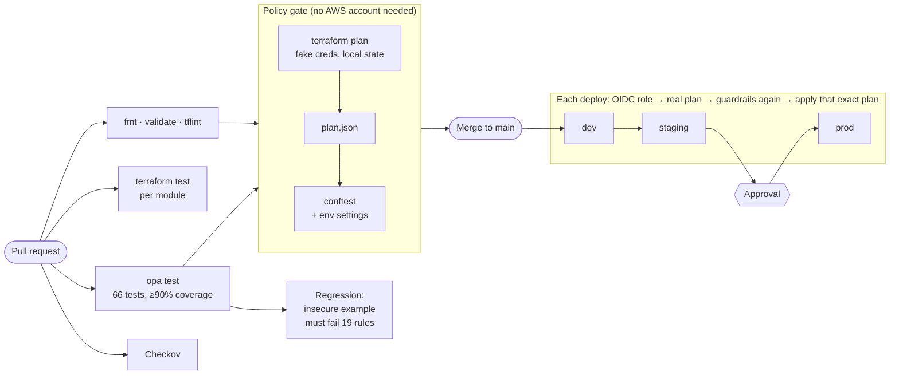

# Terraform Policy Guardrails

Reusable AWS Terraform modules, three environments built from them, and **policy as code** that blocks insecure or non-compliant infrastructure before it reaches AWS: on every pull request, and again right before each deploy.

[](https://github.com/JSR-codes/terraform-policy-guardrails/actions/workflows/ci.yml)
[](https://github.com/JSR-codes/terraform-policy-guardrails/actions/workflows/deploy.yml)

**At a glance**

- 5 tested modules (VPC, secure S3 bucket, KMS key, IAM role, security group), composed into one baseline stack
- dev / staging / prod that differ only in settings, with S3-native state locking (no DynamoDB)
- 24 OPA/Rego rules (22 blocking, 2 warnings) evaluated against the real Terraform plan, with **environment-specific** strictness
- 66 policy unit tests at 99% coverage, plus 23 module tests
- A deliberately insecure example that CI must reject, proving every rule still fires
- Pull requests are policy-checked **without AWS credentials** (offline plan)
- Deploys use GitHub OIDC, run dev → staging → prod, and prod waits for approval

## How it works



### Defence in depth

Each layer catches what the one before it can't see:

| Layer | When | Catches |
|---|---|---|
| Module input validation | `terraform plan` | Bad inputs: wrong CIDR size, wildcard trust, missing boundary, lazy SG descriptions |
| `terraform test` (mocked) | CI | Modules quietly losing a secure default |
| Checkov | CI | Known misconfigurations in the code, from a second independent rule set |
| **OPA on the plan** | CI and before every apply | What will *actually* be created, with environment-specific rules |
| Permissions boundaries | Runtime, in AWS | Anything a role tries that the plan couldn't show (e.g. policies only known after apply) |
| Bounded deploy role | Runtime, in AWS | The pipeline can only create IAM roles that carry an approved boundary |

## Policy catalog

| ID | Rule | dev | staging | prod |
|---|---|---|---|---|
| TAG-001 | Required tags: Project, Environment, Owner, CostCenter | ✓ | ✓ | ✓ |
| TAG-002 | `Environment` tag matches the environment being deployed | ✓ | ✓ | ✓ |
| S3-001 | Public access block with all four settings on | ✓ | ✓ | ✓ |
| S3-002 | Default encryption with KMS | ✓ | ✓ | ✓ |
| S3-003 | Versioning enabled | ✓ | ✓ | ✓ |
| S3-004 | No public canned ACLs | ✓ | ✓ | ✓ |
| NET-001 | Only web ports open to `0.0.0.0/0` or `::/0` | 80, 443 | 80, 443 | 443 only |
| NET-002 | Every VPC has flow logs | ✓ | ✓ | ✓ |
| NET-003 | Subnets span enough Availability Zones | ≥ 2 | ≥ 2 | ≥ 3 |
| IAM-001 | No `Allow *` on `*` | ✓ | ✓ | ✓ |
| IAM-002 | Every role has a permissions boundary | ✓ | ✓ | ✓ |
| IAM-003 | Trust policies never trust `*` | ✓ | ✓ | ✓ |
| IAM-004 | No IAM users or access keys | ✓ | ✓ | ✓ |
| IAM-005 | GitHub OIDC trust pins the repo, with no org-wide wildcards | ✓ | ✓ | ✓ |
| KMS-001 | Key rotation on | ✓ | ✓ | ✓ |
| KMS-002 | Minimum key deletion window | 7 days | 30 days | 30 days |
| EC2-001 | Instance type allow-list | t3/t4g small | up to large | m7/c7/r7 large |
| EC2-002 | IMDSv2 required | ✓ | ✓ | ✓ |
| REG-001 | Approved regions only (provider and per-resource overrides) | us-east-1 | us-east-1 | + us-west-2 |
| CHG-001 | Deleting or replacing a bucket, key or database | warn | **block** | **block** |
| COST-001 | NAT gateway in dev | warn | | |
| EXC-001/002 | Waivers need reason, approver and an expiry within 90 days | ✓ | ✓ | ✓ |
| EXC-003 | Expired waiver still in the file | warn | warn | warn |

Rules live in [`policies/terraform/`](policies/terraform), per-environment settings in [`policies/data/env/`](policies/data/env).

## What a failure looks like

From `examples/noncompliant` checked against prod (abridged):

```text
FAIL - terraform.network - [NET-001] aws_security_group.ssh: tcp ports 22-22 open to 0.0.0.0/0; only [443] may face the internet
FAIL - terraform.iam     - [IAM-005] aws_iam_role.github: GitHub OIDC trust uses wildcard subject "repo:my-org/*"
FAIL - terraform.kms     - [KMS-002] aws_kms_key.weak: deletion window is 7 days; prod requires at least 30
FAIL - terraform.network - [NET-003] plan: subnets span 1 AZ(s) ["eu-west-1a"]; prod needs at least 3
FAIL - terraform.tags    - [TAG-002] aws_vpc.main: Environment tag is "dev" but this is the "prod" environment
```

Every message has a rule ID, the exact resource address and the fix. In GitHub Actions the same results appear as a table on the run summary.

## Repository layout

```text
modules/            reusable building blocks, each with tests/
  vpc/              3-tier-ready VPC, locked default SG, KMS-encrypted flow logs
  secure-bucket/    KMS, versioning, TLS-only policy, ACLs off, lifecycle
  kms-key/          rotation always on, scoped key policy
  iam-role/         boundary required; service, role or GitHub OIDC trust
  security-group/   rules as data, every rule described
stacks/baseline/    what every environment gets (composes the modules)
envs/{dev,staging,prod}/  identical code, different terraform.tfvars
bootstrap/          state bucket + GitHub OIDC plan/apply roles (run once)
policies/
  terraform/        Rego rules
  tests/            Rego unit tests and fixtures
  data/env/         per-environment strictness
  data/exceptions.yaml  time-boxed waivers
examples/noncompliant/    insecure on purpose; CI proves it's rejected
ci/ci_override.tf   turns any root into an offline plan
scripts/            policy-check.sh, regression-check.sh
```

## Run the checks locally (no AWS account)

Requires Terraform ≥ 1.11 (or OpenTofu), [conftest](https://www.conftest.dev), [opa](https://www.openpolicyagent.org) and [tflint](https://github.com/terraform-linters/tflint).

```bash
make check            # everything CI runs
make policy ENV=prod  # one environment's guardrails
make regression       # prove the rules still fire
```

## Deploy to AWS

> Creates billable resources. With NAT off (the default) the main cost is about $1/month per KMS key, prorated, plus a few cents of logs and storage. Run `terraform destroy` per environment when you're done.

**1. Bootstrap (once, with admin credentials)**

```bash
cd bootstrap
# set account_id in terraform.tfvars
terraform init && terraform apply
terraform output
```

**2. Point each environment at the state bucket** and set `account_id` in every `envs/*/terraform.tfvars`:

```bash
cp envs/dev/backend.hcl.example envs/dev/backend.hcl   # repeat for staging and prod
```

**3. Deploy from your machine** (optional; the pipeline can do it instead):

```bash
cd envs/dev && terraform init -backend-config=backend.hcl && terraform apply
```

**4. Deploy from GitHub Actions**

- Settings → Environments: create `dev`, `staging` and `prod`. Add yourself as a required reviewer on `prod`.
- Settings → Secrets and variables → Actions:
  - Secret `AWS_APPLY_ROLE_ARN` = `terraform -chdir=bootstrap output -raw apply_role_arn`
  - Variable `TF_STATE_BUCKET` = `terraform -chdir=bootstrap output -raw state_bucket`
  - Variable `DEPLOY_ENABLED` = `true`
- Push to `main`. Dev and staging deploy, then prod waits for your approval.

## Waivers

Sometimes a rule has to bend, such as during a planned bucket migration. Add an entry to [`policies/data/exceptions.yaml`](policies/data/exceptions.yaml):

```yaml
exceptions:
  - rule: CHG-001
    address: module.baseline.module.data_bucket.*
    reason: Moving data to the new bucket, ticket CHG-1234
    approved_by: platform-lead
    expires: "2026-12-01T00:00:00Z"
```

The waiver is reviewed in the pull request like any other change. It covers only that rule on those addresses. EXC-002 rejects expiries more than 90 days out, and an expired waiver stops applying on its own.

## Adding a rule

1. Add a `violations contains v if { ... }` block with a new ID to the right file in `policies/terraform/`.
2. Add passing and failing cases in `policies/tests/`.
3. Add a resource that breaks it to `examples/noncompliant/main.tf` and its ID to `expected-violations.txt`.
4. Add it to the catalog above. CI enforces steps 2 and 3.

## Design decisions

- **Policies read the plan, not the code.** Checkov reads HCL; OPA reads `terraform show -json`, which has variables resolved, modules expanded and provider defaults applied. That's how one rule can be strict in prod and relaxed in dev.
- **Offline plans on pull requests.** Modules avoid data sources that call AWS, so `ci/ci_override.tf` (local state, fake credentials) produces a complete plan with no account at all. Forks and new contributors get the full policy gate, and CI holds no cloud credentials.
- **Checked again before apply.** The deploy plan sees real state, so CHG-001 can spot a change that would replace a production bucket, which an offline plan can't know.
- **The exact plan that passed is the one applied.** The binary plan is saved and passed straight to `terraform apply`.
- **S3-native state locking** (`use_lockfile`, Terraform 1.11+) instead of a DynamoDB table, which HashiCorp has deprecated for the S3 backend.
- **Environments differ only in data.** `envs/*` contain identical code; the differences live in `terraform.tfvars` and `policies/data/env/*.yaml`, so environments can't drift structurally.
- **One account, prefixed names.** Fine for a demo. A real organisation would put each environment in its own AWS account and add SCPs above all of this.

### Known limits

- Some values are unknown until apply, such as an inline IAM policy that references a bucket ARN created in the same plan. Those rules skip unknowns, and the permissions boundary is the runtime backstop.
- Plan JSON doesn't link resources by ID before apply, so "this bucket has a public access block" matches resources within the same module instance. The modules follow that pattern; the regression example confirms resources in different modules don't borrow each other's controls.

### Bugs the tests caught while building this

- **Untagged resources were passing TAG-001.** With no tags at all, Terraform leaves `tags_all` unknown, and the first version of the rule skipped unknown values. The insecure example exposed it; the rule now falls back to the resource's own tags.
- **Waivers like `module.data.*` matched nothing.** OPA's `glob.match` treats `.` as a separator by default. A unit test caught it, and another test now proves `module.data.*` doesn't also match `module.database`.

## Results

Fill in after deploying.

| Metric | Result |
|---|---|
| Pull request policy gate duration | _TBD_ |
| Deploy duration dev → staging (before approval) | _TBD_ |
| Violations caught by CI on real pull requests | _TBD_ |
| Monthly cost of all three environments | _TBD_ |

## License

MIT
